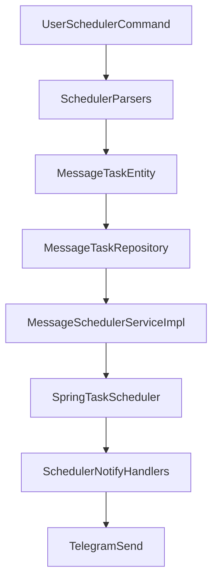

# Scheduler Flow Map

## Purpose

Describe how delayed and repeated tasks are parsed, stored, and executed.

## Sequence

## Core Components

- Parsers: `scheduler/parser/`
- Service: `scheduler/service/MessageSchedulerServiceImpl.java`
- Entities/repo: `model/MessageTask.java`, `repository/MessageTaskRepository.java`
- Scheduler bean config: `config/SchedulerConfig.java` and `AppConfig.java`

## Startup Behavior

- Existing tasks are loaded from persistence.
- Future executions are restored into in-memory scheduled futures.
- Task cancellation or updates should synchronize DB state and in-memory schedules.

## Risk Checklist

- Time zone handling can produce unexpected schedule offsets.
- Repeating tasks require careful rescheduling to avoid duplicate jobs.
- Deletion/cancel paths must clear both persistent and runtime state.
