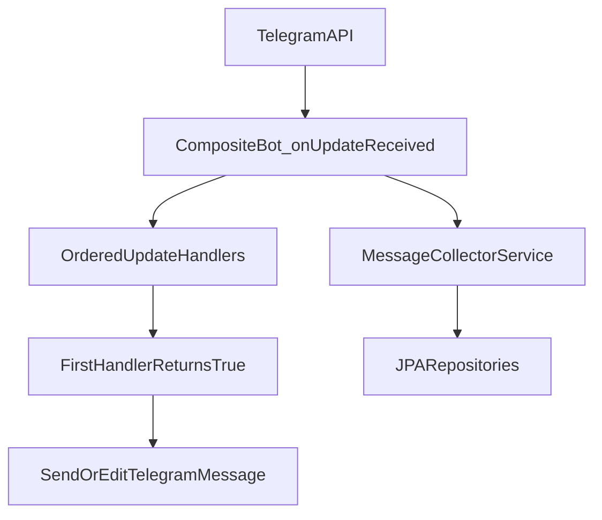

# Update Flow Map

## Purpose

This document explains how an incoming Telegram update is processed and persisted.

## Sequence

## Behavioral Notes

- Handler order is defined in `src/main/resources/spring/botConfig.xml`.
- Update processing uses chain-of-responsibility: first matching handler wins.
- Logging and usage collection are executed in `CompositeBot` wrappers.
- Message persistence behavior depends on chat configuration and update type.

## Where To Edit

- Add/modify handler logic: `src/main/java/ru/javazen/telegram/bot/handler/`
- Add/modify filters: `src/main/java/ru/javazen/telegram/bot/filter/`
- Rewire handler order: `src/main/resources/spring/botConfig.xml`
- Adjust persistence: `src/main/java/ru/javazen/telegram/bot/service/impl/MessageCollectorServiceImpl.java`

## Risk Checklist

- Reordering handlers can silently change behavior.
- A permissive filter can shadow handlers later in the chain.
- Changes to update mapping should be validated with existing tests and manual bot scenarios.
